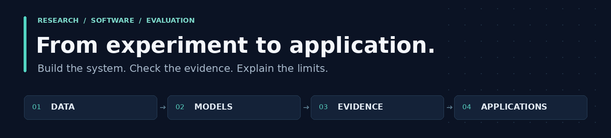

# Suyambu Raj Kanagaraj

**AI engineering · Computer vision · Applied machine learning**

I build research and data applications, with a focus on measurable results, reliable workflows, and clear limitations.

[Explore projects](#explore-my-work) · [Engineering](#engineering-in-the-repositories) · [Connect](#connect)

<a href="#explore-my-work">
<picture>
  <source media="(prefers-reduced-motion: no-preference)" srcset="assets/profile-flow.gif">
  
</picture>
</a>

## Explore my work

Choose a project, try its app, or expand the technical details below.

| Project | Focus | Explore |
| :--- | :--- | :--- |
| **[NeuroPrompt-3D](#neuroprompt-3d)** | 3D MRI, uncertainty, research visualization | [Research app ↗](https://neuroprompt-3d.vercel.app/) |
| **[New Delhi Traffic](#new-delhi-traffic-forecasting)** | Next-hour forecasting, temporal evaluation | [Historical demo ↗](https://new-delhi-traffic-forecasting.streamlit.app/) |
| **[Volve Field Intelligence](#volve-field-intelligence)** | Industrial analytics, model reliability | [Explore dashboard ↗](https://volve-field-intelligence.streamlit.app/) |
| **[RecallDesk](#recalldesk)** | Team engineering, evidence review, SQLite | [Team demo ↗](https://recall-desk.streamlit.app/) |

*Streamlit demos may sleep after inactivity and require a wake-up.*

### NeuroPrompt-3D

**Uncertainty-aware 3D MRI segmentation · Hosted research prototype**

Built a multimodal MRI workflow combining a PyTorch 3D U-Net, MC Dropout, automatic prompts, and SAM-Med3D integration, with a FastAPI backend and React/TypeScript/Three.js interface.

**129 test cases / 62 held-out subjects.** The frozen policy reduced mean HD95 but lowered mean Dice and IoU. Research use only; not clinically validated.

<strong>Inspect evaluation, reproducibility & attribution</strong>

| Mean metric | Baseline | Frozen policy |
| :--- | ---: | ---: |
| Dice ↑ | 0.7663 | 0.7625 |
| IoU ↑ | 0.6425 | 0.6387 |
| HD95, mm ↓ | 24.30 | 23.66 |

The policy retained the baseline in **85 cases** and applied refinement in **44**. Subject-level separation and SHA-256 evidence checks support the frozen evaluation.

These are repository-reported frozen results. Full re-evaluation requires external research data, weights, and artifacts; the public source is not a complete fresh-machine reproduction package.

Independent implementation and evaluation; the initial concept and specification are credited in the project provenance.

[Methods & attribution](https://github.com/ksuyamburaj07/NeuroPrompt-3D/blob/public-release/docs/PROJECT_PROVENANCE.md) · [Scientific boundaries](https://github.com/ksuyamburaj07/NeuroPrompt-3D/blob/public-release/docs/SCIENTIFIC_BOUNDARIES.md) · [Validation record](https://github.com/ksuyamburaj07/NeuroPrompt-3D#validation)

### New Delhi Traffic Forecasting

**BSc final-year project · Historical forecasting demo**

Forecasts next-hour traffic **probe activity** across ten selected New Delhi roads. Random Forest achieved **6.16% WAPE** and **52.10% lower MAE than persistence** on a 960-observation chronological holdout. That same holdout informed model selection.

<strong>Explore the forecasting workflow & evaluation</strong>

- Temporal features and expanding-window evaluation.
- Saved predictions, model comparisons, and a fitted scikit-learn pipeline.
- Streamlit controls for historical road/date/hour exploration.

The target measures aggregated probe activity, not exact vehicle counts or congestion percentages. The app uses historical observations, not a live traffic feed. Because model selection used the holdout, it is not an untouched final model-selection test.

[Evaluation artifacts](https://github.com/ksuyamburaj07/FYP_NewDelhi_Traffic/tree/main/outputs) · [Model-development notebook](https://github.com/ksuyamburaj07/FYP_NewDelhi_Traffic/blob/main/notebooks/02_Next_Hour_Traffic_Forecasting_Colab.ipynb)

### Volve Field Intelligence

**Industrial data analysis · Baselines and model reliability**

Built historical production monitoring and next-month forecasting for **five producer wells**. On **80 temporal holdout forecasts**, persistence outperformed Ridge: **17.55% vs 33.10% WAPE**.

<strong>Explore model reliability & reproduction evidence</strong>

Preserved the negative result, including **12 negative Ridge predictions**, in the reliability analysis. The Streamlit/Plotly app presents frozen historical artifacts rather than retraining the model.

Includes a frozen model manifest, saved holdout predictions, and notebook-recorded saved-model consistency checks. Reproducing the raw-data workflow requires the original dataset and local path adjustments.

[Frozen evaluation](https://github.com/ksuyamburaj07/Volve_Oil_Production/tree/main/outputs/03_model_development) · [Application validation notebook](https://github.com/ksuyamburaj07/Volve_Oil_Production/blob/main/notebooks/05_Application_Integration_and_Final_System_Validation.ipynb)

### RecallDesk

**Team Redline Agents · AMD Developer Hackathon Act III**

Collaborative educational pharmacy recall-review prototype using **synthetic inventory data** and simulated review roles.

My contributions focused on matching, SQLite persistence, audit history, revision-aware review, PDF evidence export, and regression tests.

<strong>Explore my contributions to the team project</strong>

- Conservative evidence matching and regression tests.
- Versioned SQLite persistence and audit safeguards.
- Revision-aware decisions, stale-revision checks, and Review/Export workflows.
- Saved-case PDF evidence export.

This was a team delivery. The repository and application include collaborators' work alongside my contributions.

[My commit history](https://github.com/husnainakram09/recall-desk/commits/main/?author=ksuyamburaj07) · [Team tests](https://github.com/husnainakram09/recall-desk/tree/main/tests)

## Engineering in the repositories

| Area | Demonstrated work |
| :--- | :--- |
| Modeling | Python, PyTorch, scikit-learn pipelines, Random Forest, Ridge, 3D segmentation |
| Evaluation | Subject-level separation, temporal validation, persistence baselines, frozen predictions, explicit failure analysis |
| Applications | FastAPI, React, TypeScript, Three.js, Streamlit, Plotly |
| Data & testing | pandas, NumPy, SQLite, pytest regressions, MRI input validation, audit-integrity and stale-revision safeguards |

<strong>Inspect engineering validation</strong>

[NeuroPrompt MRI input-validation tests](https://github.com/ksuyamburaj07/NeuroPrompt-3D/blob/public-release/tests/m11/test_case_validation_api.py) cover research input checks. [RecallDesk regression tests](https://github.com/husnainakram09/recall-desk/tree/main/tests) cover matching, persistence, audit, review, and export behavior.

The forecasting projects include notebook assertions and saved-artifact checks. Test source and recorded validations are linked as evidence; they do not imply a current CI pass or independent fresh-machine reproduction.

## Connect

Interested in computer vision, applied ML, or research software?

[Connect on LinkedIn](https://www.linkedin.com/in/suyambu-raj-kanagaraj/) · [Browse my repositories](https://github.com/ksuyamburaj07?tab=repositories) · [Back to projects ↑](#explore-my-work)
