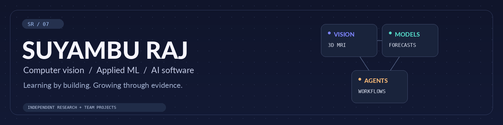

# Hi, I'm Suyambu 👋

**AI engineering · Computer vision · Applied machine learning**

Research questions, working applications, and the lessons between them.

[About me](#about-me) · [Projects](#explore-my-work) · [Toolkit](#toolkit) · [Certificates](#hackathon-participation) · [Say hello](#connect)

<a href="#explore-my-work">
<picture>
  <source media="(prefers-reduced-motion: no-preference)" srcset="assets/identity/banner.gif">
  
</picture>
</a>

## A little about me

I'm **Suyambu Raj Kanagaraj**. My work has grown from a Computer Science final-year forecasting project into **3D brain MRI research** and collaborative **AI hackathons**.

I like turning a question into something people can explore: a model, a working interface, and an evaluation that explains what happened. Baselines, failed ideas, and limitations are part of that story.

- **Independent research:** I implemented and evaluated NeuroPrompt-3D, with the original concept credited in its provenance.
- **Team engineering:** With **Team Redline Agents**, I contribute backend workflows, persistence, safeguards, and testing to RecallDesk and Lab2Care.
- **My direction:** computer vision, applied ML, and AI applications with clear evidence and human oversight.

## Featured projects

Start with a demo, or open the notes to inspect the engineering.

| Build | What you'll find | Try it / inspect it |
| :--- | :--- | :--- |
| **[NeuroPrompt-3D](#neuroprompt-3d)** | Independent 3D MRI research and interactive visualization | [Research preview ↗](https://neuroprompt-3d.vercel.app/) · [Source](https://github.com/ksuyamburaj07/NeuroPrompt-3D) |
| **[New Delhi Traffic](#new-delhi-traffic-forecasting)** | Historical next-hour probe-activity forecasting | [Demo ↗](https://new-delhi-traffic-forecasting.streamlit.app/) · [Source](https://github.com/ksuyamburaj07/FYP_NewDelhi_Traffic) |
| **[Volve Field Intelligence](#volve-field-intelligence)** | Historical industrial analytics and model reliability | [Dashboard ↗](https://volve-field-intelligence.streamlit.app/) · [Source](https://github.com/ksuyamburaj07/Volve_Oil_Production) |
| **[RecallDesk](#recalldesk)** | Team pharmacy recall-review prototype with synthetic stock | [Team demo ↗](https://recall-desk.streamlit.app/) · [Source](https://github.com/husnainakram09/recall-desk) |
| **[Lab2Care](#lab2care)** | Team AI follow-up prototype with fictional cases | [Team demo ↗](https://155-138-224-75.sslip.io/) · [Source](https://github.com/husnainakram09/Lab2Care) |

*Streamlit demos may need a moment to wake after inactivity.*

### NeuroPrompt-3D

**🧠 Independent implementation & evaluation · Research prototype**

An uncertainty-aware **3D MRI segmentation** workflow built with PyTorch and FastAPI, explored through a React/TypeScript/Three.js interface.

The frozen evaluation covers **129 cases from 62 held-out subjects**. The final policy lowered mean HD95 while also lowering mean Dice and IoU. Research use only; not clinically validated.

[Open research preview ↗](https://neuroprompt-3d.vercel.app/) · [Explore the source](https://github.com/ksuyamburaj07/NeuroPrompt-3D)

<strong>Open the research notes: results, methods & credit</strong>

| Mean metric | Baseline | Frozen policy |
| :--- | ---: | ---: |
| Dice ↑ | 0.7663 | 0.7625 |
| IoU ↑ | 0.6425 | 0.6387 |
| HD95, mm ↓ | 24.30 | 23.66 |

The policy retained the baseline in **85 cases** and applied refinement in **44**. Subject-level separation and SHA-256 evidence checks support the frozen evaluation.

These are repository-reported frozen results. Full re-evaluation requires external research data, weights, and artifacts; the public source is not a complete fresh-machine reproduction package.

Independent implementation and evaluation; the initial concept and specification are credited in the project provenance.

[Methods & attribution](https://github.com/ksuyamburaj07/NeuroPrompt-3D/blob/public-release/docs/PROJECT_PROVENANCE.md) · [Scientific boundaries](https://github.com/ksuyamburaj07/NeuroPrompt-3D/blob/public-release/docs/SCIENTIFIC_BOUNDARIES.md) · [Validation record](https://github.com/ksuyamburaj07/NeuroPrompt-3D#validation)

### New Delhi Traffic Forecasting

**🚦 BSc final-year project · Historical ML application**

Next-hour forecasting of **traffic probe activity across ten selected New Delhi roads**, with Random Forest, temporal features, baseline comparison, and a Streamlit interface.

[Try the historical demo ↗](https://new-delhi-traffic-forecasting.streamlit.app/) · [Explore the source](https://github.com/ksuyamburaj07/FYP_NewDelhi_Traffic)

<strong>Open the forecasting notes: evaluation & scope</strong>

Random Forest achieved **6.16% WAPE** and **52.10% lower MAE than persistence** on a **960-observation chronological holdout**. The same holdout informed model selection.

- Temporal features and expanding-window evaluation.
- Saved predictions, model comparisons, and a fitted scikit-learn pipeline.
- Streamlit controls for historical road/date/hour exploration.

The target measures aggregated probe activity, not exact vehicle counts or congestion percentages. The app uses historical observations, not a live traffic feed. Because model selection used the holdout, it is not an untouched final model-selection test.

[Evaluation artifacts](https://github.com/ksuyamburaj07/FYP_NewDelhi_Traffic/tree/main/outputs) · [Model-development notebook](https://github.com/ksuyamburaj07/FYP_NewDelhi_Traffic/blob/main/notebooks/02_Next_Hour_Traffic_Forecasting_Colab.ipynb)

### Volve Field Intelligence

**🛢️ Industrial data science · Historical forecasting & reliability**

Production monitoring and next-month forecasting for **five Volve producer wells**. The evaluation preserved a useful negative result: **persistence outperformed Ridge**.

[Explore the dashboard ↗](https://volve-field-intelligence.streamlit.app/) · [Explore the source](https://github.com/ksuyamburaj07/Volve_Oil_Production)

<strong>Open the reliability notes: when the baseline wins</strong>

On **80 temporal holdout forecasts across five producer wells**, persistence achieved **17.55% WAPE**, compared with **33.10% for Ridge**.

Preserved the negative result, including **12 negative Ridge predictions**, in the reliability analysis. The Streamlit/Plotly app presents frozen historical artifacts rather than retraining the model.

Includes a frozen model manifest, saved holdout predictions, and notebook-recorded saved-model consistency checks. Reproducing the raw-data workflow requires the original dataset and local path adjustments.

[Frozen evaluation](https://github.com/ksuyamburaj07/Volve_Oil_Production/tree/main/outputs/03_model_development) · [Application validation notebook](https://github.com/ksuyamburaj07/Volve_Oil_Production/blob/main/notebooks/05_Application_Integration_and_Final_System_Validation.ipynb)

### RecallDesk

**💊 Team Redline Agents · AMD Developer Hackathon Act III**

A collaborative pharmacy recall-review prototype using **synthetic inventory and simulated review roles**.

**My part:** conservative matching, versioned SQLite persistence, audit safeguards, revision-aware review, PDF evidence export, and regression tests.

[Try the team demo ↗](https://recall-desk.streamlit.app/) · [Explore the team source](https://github.com/husnainakram09/recall-desk)

<strong>Open my contribution notes</strong>

- Conservative evidence matching and regression tests.
- Versioned SQLite persistence and audit safeguards.
- Revision-aware decisions, stale-revision checks, and Review/Export workflows.
- Saved-case PDF evidence export.

This was a team delivery. The repository and application include collaborators' work alongside my contributions.

[My commit history](https://github.com/husnainakram09/recall-desk/commits/main/?author=ksuyamburaj07) · [Team tests](https://github.com/husnainakram09/recall-desk/tree/main/tests)

### Lab2Care

**🤖 Team Redline Agents · Vultr: Agent Rush Hackathon**

A collaborative laboratory-results follow-up prototype using **fictional cases and simulated clinical roles**. Bounded AI investigation prepares staff drafts; approval, fictional delivery, and acknowledgement remain separate steps.

**My part:** the initial Python/FastAPI foundation, report reconciliation, version-aware SQLite workflows, Vultr inference tools, research adapters, regression tests, deployment-script improvements, and VM integration/testing. Later integration and presentation were team work.

<strong>Open my implementation & deployment notes</strong>

- Deterministic reconciliation preserves missing, mismatched, and conflicting report evidence for review.
- Transactional, version-aware SQLite transitions reject stale changes and protect audit history.
- Case-scoped agent tools inspect evidence and prepare unexecuted clarification/escalation drafts; they cannot approve clinical decisions or automatically attach reports.
- Simulated clinician approval, notification queuing, fake delivery, and receipt acknowledgement are distinct workflow stages.
- Research data adapters support aggregate audits; regression tests cover reconciliation, persistence, agent boundaries, approvals, and follow-up states.
- Deployment contributions include reproducible startup, active-database health checks, startup-script fixes, and hands-on VM integration checks for the hackathon demo.

[My initial implementation](https://github.com/husnainakram09/Lab2Care/commit/aaec480eda4cc16f53c30667384533ad7c5f2527) · [My startup contribution](https://github.com/husnainakram09/Lab2Care/commit/af0abf082f00622ca1dbae01780139c3924fd219) · [Current team tests](https://github.com/husnainakram09/Lab2Care/tree/0162cfcfc856935d5ceacec36d27e7acb2ed2467/tests)

## What I build with

Tools you'll find in the projects above, grouped by how I use them.

**AI & data**

**Applications & agents**

**Engineering & testing**

<strong>See the implementation & validation evidence</strong>

| Area | Demonstrated work |
| :--- | :--- |
| Modeling | Python, PyTorch, scikit-learn pipelines, Random Forest, Ridge, 3D segmentation |
| Evaluation | Subject-level separation, temporal validation, persistence baselines, frozen predictions, explicit failure analysis |
| Applications | FastAPI, React, TypeScript, Three.js, Streamlit, Plotly |
| Data & testing | pandas, NumPy, SQLite, pytest/unittest regressions, MRI input validation, audit-integrity and stale-revision safeguards |
| Agentic workflows | Vultr Serverless Inference, allowlisted tool calling, version-aware state transitions, simulated approval gates |

[NeuroPrompt MRI input-validation tests](https://github.com/ksuyamburaj07/NeuroPrompt-3D/blob/public-release/tests/m11/test_case_validation_api.py) cover research input checks. [RecallDesk regression tests](https://github.com/husnainakram09/recall-desk/tree/main/tests) cover matching, persistence, audit, review, and export behavior.

[Lab2Care workflow tests](https://github.com/husnainakram09/Lab2Care/tree/0162cfcfc856935d5ceacec36d27e7acb2ed2467/tests) cover reconciliation, case versions, agent boundaries, simulated approval, delivery, and acknowledgement.

The forecasting projects include notebook assertions and saved-artifact checks. Test source and recorded validations are linked as evidence; they do not imply a current CI pass or independent fresh-machine reproduction.

## Hackathon participation

Official **Certificates of Completion — Participant**, linked to my team projects.

| Hackathon / project | Certificate issued | Verification |
| :--- | :--- | :--- |
| **Vultr: Agent Rush Hackathon** · [Lab2Care](#lab2care) | 9 November 2026 | [View certificate](https://lablab.build/u/@ksuyambu_raj07/ai-hackathons/vultr-hackathon/certificate) |
| **AMD Developer Hackathon: ACT III** · [RecallDesk](#recalldesk) | 5 November 2026 | [View certificate](https://lablab.build/u/@ksuyambu_raj07/ai-hackathons/amd-developer-hackathon-act-iii/certificate) |

## Let's connect

Have a research question, an AI project, or feedback on one of my builds? Say hello.

**[ksuyamburaj07@gmail.com](mailto:ksuyamburaj07@gmail.com)** · [LinkedIn](https://www.linkedin.com/in/suyambu-raj-kanagaraj/)

This profile grows as I finish projects and document what I learn.

[Back to the top ↑](#top)
